# Hướng dẫn bấm thử có ảnh — đợt gop-staging-1410m (16/10/2026)

Ảnh chụp trực tiếp trên staging (https://staging.dr4women.io.vn) lúc bấm lại, tài khoản Quản lý hệ thống. Dữ liệu khách đã che. Mỗi mục: trang · có gì · cần theo dõi gì · bấm vào đâu thì đi đâu.

Các luồng nhiều bước (khách trả thuốc, nhận chéo giữa phòng, kiểm kê + chuông, bán theo đơn, duyệt vật tư bằng hai tài khoản) viết từng bước ở `docs/HUONG-DAN-BAM-THU-NOTION-1610.md` mục 11; các ảnh của luồng đó chụp lúc bấm buổi sáng chưa đưa vào đây.

## 1. Báo cáo cuối ngày, dòng tiền, hoá đơn

### Báo cáo cuối ngày

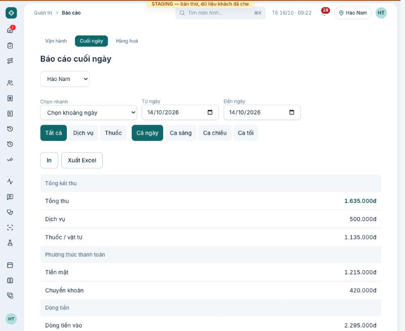

- **Vào bằng:** Menu Báo cáo → tab Cuối ngày
- **Có gì:** Chọn cơ sở, khoảng ngày (có nút chọn nhanh), lọc Tất cả / Dịch vụ / Thuốc và theo ca (Cả ngày, Ca sáng, Ca chiều, Ca tối). Khối Tổng kết thu: tổng thu, dịch vụ, thuốc/vật tư, tiền mặt, chuyển khoản.
- **Cần theo dõi:** Tổng thu phải bằng dịch vụ + thuốc/vật tư, và bằng tiền mặt + chuyển khoản. Nhân viên chỉ thấy ca mình được xếp trực; trưởng ca chỉ thấy cả ngày khi có lịch trưởng ca được duyệt.
- **Bấm → tới đâu:** In / Xuất Excel ở trên bảng. Kéo xuống để sang khối Dòng tiền.

### Dòng tiền

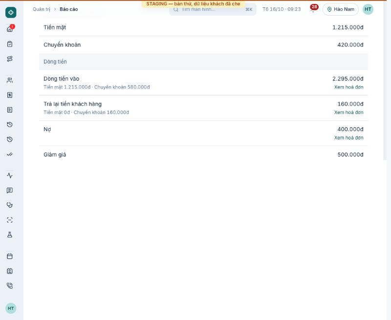

- **Vào bằng:** Cùng trang, kéo xuống dưới khối Tổng kết thu
- **Có gì:** Dòng tiền vào (tách tiền mặt / chuyển khoản), Trả lại tiền khách hàng, Nợ, Giảm giá. Mỗi dòng có link Xem hoá đơn.
- **Cần theo dõi:** Thực thu = vào − trả lại − nợ − giảm giá + nợ thu được. Nợ và giảm giá là việc bình thường, không phải lỗi.
- **Bấm → tới đâu:** Bấm Xem hoá đơn → mở Danh sách hoá đơn liên quan đến dòng đó.

### Báo cáo hàng hoá

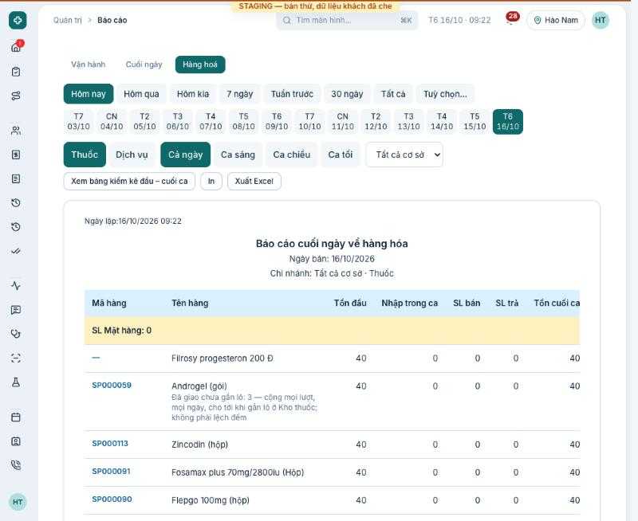

- **Vào bằng:** Menu Báo cáo → tab Hàng hoá
- **Có gì:** Bảng Tồn đầu, Nhập trong ca, SL bán, SL trả, Tồn cuối ca theo từng thuốc; dòng cảnh báo SL mặt hàng; chọn ca (Cả ngày, Ca sáng, Ca chiều, Ca tối).
- **Cần theo dõi:** Tồn cuối = Tồn đầu + Nhập − Bán + Trả + Khác. Chỉ thuốc kê theo đơn hiện ở đây; vật tư bán thêm chưa liệt kê từng món (việc tồn đọng).
- **Bấm → tới đâu:** Link Xem bảng kiểm kê đầu – cuối ca → sang bảng kiểm kê ca của Kho thuốc.

### Danh sách hoá đơn

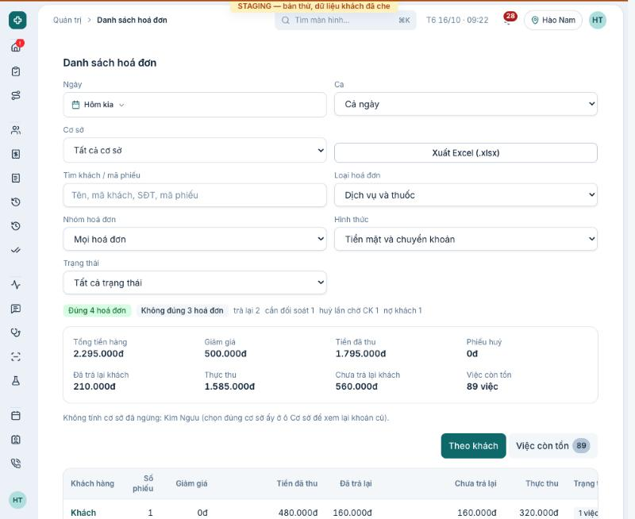

- **Vào bằng:** Từ link Xem hoá đơn ở báo cáo, hoặc menu Danh sách hoá đơn
- **Có gì:** Bộ lọc ngày, ca, cơ sở, loại hoá đơn, hình thức, trạng thái; thanh Đúng 4 / Không đúng 3; các ô tổng tiền hàng, giảm giá, thực thu, chưa trả lại khách.
- **Cần theo dõi:** Số Không đúng và Chưa trả lại khách cần nhìn; Việc còn tồn (89) là các việc chưa xử lý của kỳ trước.
- **Bấm → tới đâu:** Xuất Excel (.xlsx) tải danh sách; Theo khách gom theo khách; Việc còn tồn mở danh sách việc.

### Xuất hoá đơn

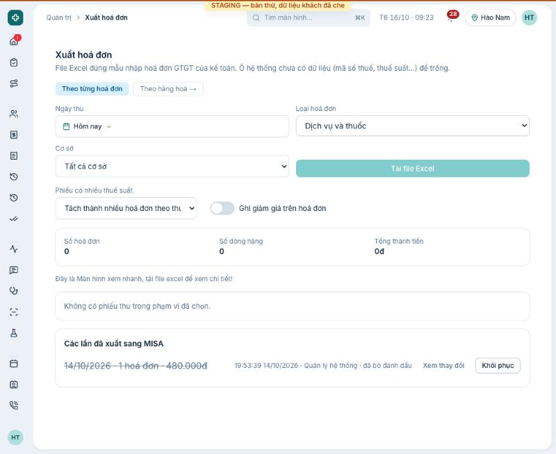

- **Vào bằng:** Menu Xuất hoá đơn
- **Có gì:** Xuất Excel đúng mẫu nhập hoá đơn GTGT của kế toán (MISA). Chọn ngày thu, loại hoá đơn, cơ sở; tuỳ chọn tách hoá đơn theo thuế suất và ghi giảm giá trên hoá đơn.
- **Cần theo dõi:** Ô Số hoá đơn / Số dòng hàng / Tổng thanh toán xem trước khi tải. Mã số thuế, thuế suất chưa có thì để trống. Bảng Các lần đã xuất MISA cho phép Khôi phục lần đã đánh dấu.
- **Bấm → tới đâu:** Tải file Excel (cần có phiếu thu trong phạm vi chọn); Khôi phục trả phiếu về trạng thái chưa xuất.

### Thiết lập báo cáo

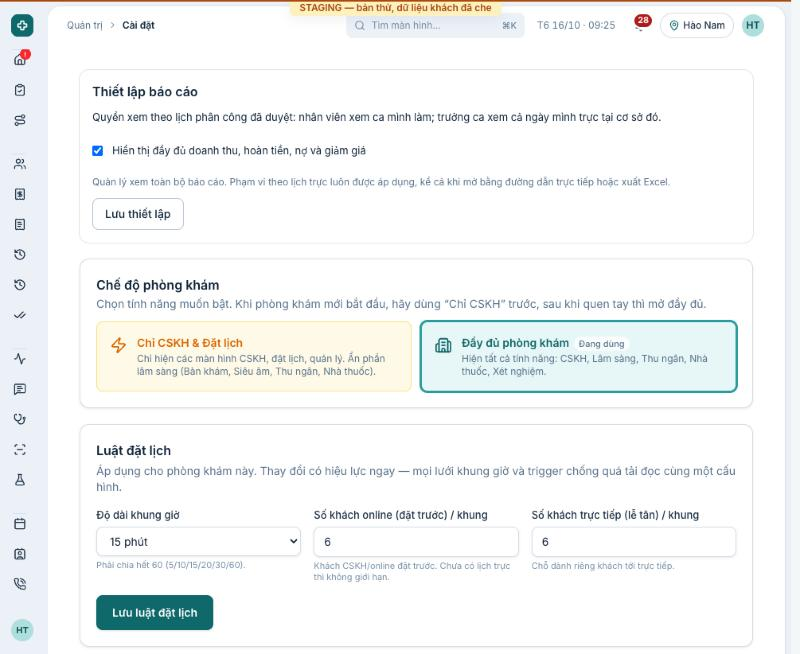

- **Vào bằng:** Menu Cài đặt
- **Có gì:** Ô tick Hiển thị đầy đủ doanh thu, hoàn tiền, nợ và giảm giá; áp cho toàn bộ báo cáo kể cả khi mở bằng đường dẫn trực tiếp hoặc xuất Excel.
- **Cần theo dõi:** Tắt ô này thì người xem chỉ thấy phạm vi được cho phép.
- **Bấm → tới đâu:** Lưu thiết lập.

## 2. Kho thuốc

### Tồn theo lô

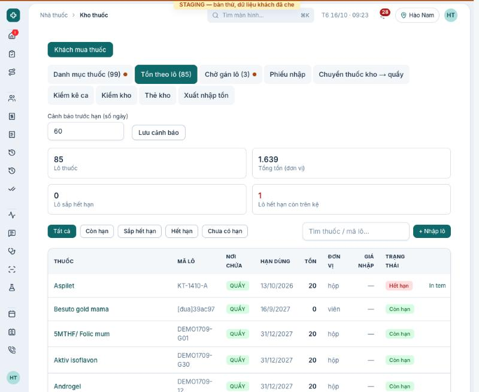

- **Vào bằng:** Menu Kho thuốc → tab Tồn theo lô
- **Có gì:** Bốn ô số: lô thuốc, tổng tồn, lô sắp hết hạn, lô hết hạn còn tồn kê. Bảng thuốc có cột Nơi chứa (QUẦY / KHO), hạn dùng, tồn, đơn vị, giá nhập, trạng thái.
- **Cần theo dõi:** Ô Cảnh báo trước hạn (số ngày) đang 60. Lô hết hạn còn tồn kê hiện màu đỏ vì đó là lỗi thật cần xử lý.
- **Bấm → tới đâu:** Nhập lô thêm lô mới; ô tìm theo thuốc hoặc mã lô; các chip Còn hạn / Sắp hết hạn / Hết hạn / Chưa có hạn.

### Kiểm kê ca

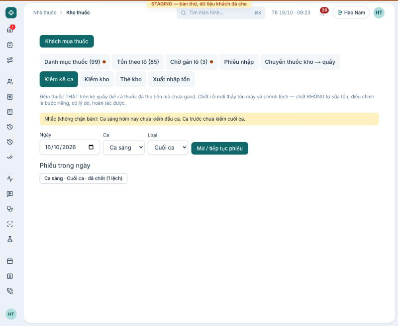

- **Vào bằng:** Kho thuốc → tab Kiểm kê ca
- **Có gì:** Chọn ngày, ca, loại (Đầu ca / Cuối ca) rồi Mở / tiếp tục phiếu. Nhắc không chặn bán nếu ca trước chưa kiểm cuối ca.
- **Cần theo dõi:** Đếm thuốc THẬT trên quầy; hệ thống chỉ ghi chênh lệch, không tự sửa tồn. Điều chỉnh phải qua bước riêng, có lý do.
- **Bấm → tới đâu:** Phiếu trong ngày hiện thành chip, bấm vào để xem lại phiếu đã chốt.

### Phiếu nhập hàng

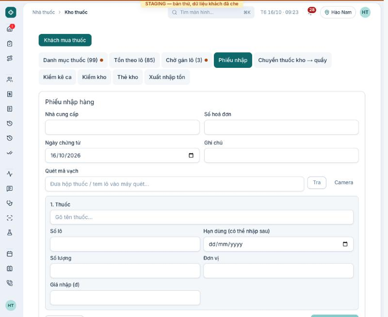

- **Vào bằng:** Kho thuốc → tab Phiếu nhập
- **Có gì:** Nhà cung cấp, số hoá đơn, ngày chứng từ, ô quét mã vạch / QR, rồi từng dòng thuốc: số lô, hạn dùng, số lượng, đơn vị, giá nhập.
- **Cần theo dõi:** Thuốc cần duyệt nhập sẽ không vào kho ngay; nó chờ người có quyền Duyệt vật tư.
- **Bấm → tới đâu:** Quét mã → điền sẵn thuốc, lô, hạn nếu mã có; Lưu phiếu → thuốc vào lô.

### Chuyển thuốc kho → quầy

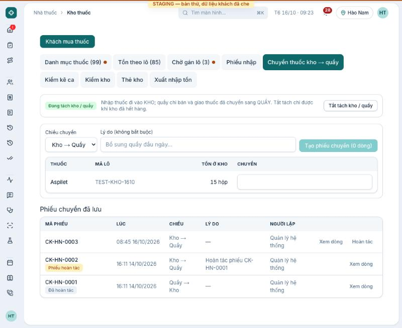

- **Vào bằng:** Kho thuốc → tab Chuyển thuốc kho → quầy
- **Có gì:** Công tắc Đang tách kho / quầy. Khi tách: nhập thuốc vào KHO, quầy chỉ bán và giao thuốc đã chuyển sang QUẦY. Có chiều chuyển, lý do, số lượng chuyển và danh sách Phiếu chuyển đã lưu (CK-HN-0001…).
- **Cần theo dõi:** Mỗi phiếu có người lập và có thể Hoàn tác (đánh dấu Đã hoàn tác / Phiếu hoàn tác). Chưa tách thì quầy bán như cũ.
- **Bấm → tới đâu:** Tạo phiếu chuyển → tồn kho giảm, tồn quầy tăng; Hoàn tác trả lại.

### Kiểm kho

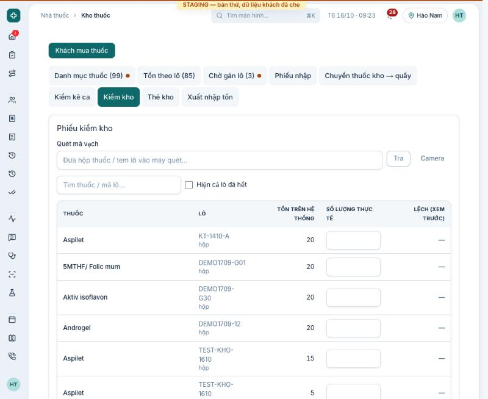

- **Vào bằng:** Kho thuốc → tab Kiểm kho
- **Có gì:** Quét mã hoặc tìm thuốc, cột Tồn trên hệ thống, ô Số lượng thực tế, cột Lệch.
- **Cần theo dõi:** Lệch = số thực tế − tồn hệ thống. Kiểm kê ca chỉ tính hàng ở quầy.
- **Bấm → tới đâu:** Nhập số thực tế và chốt → phát sinh điều chỉnh có dấu vết.

### Xuất nhập tồn

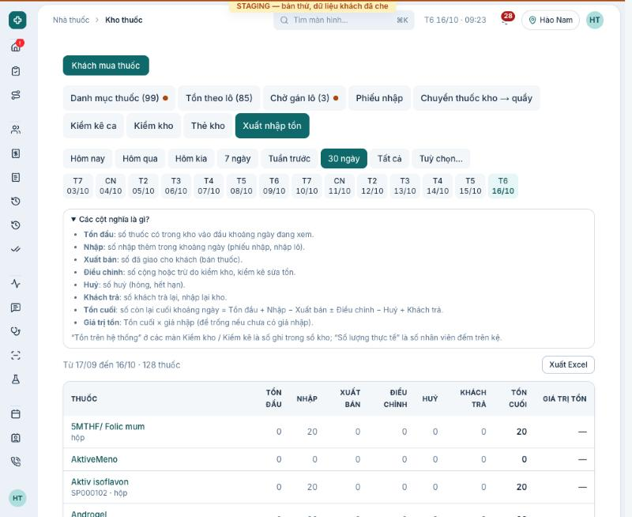

- **Vào bằng:** Kho thuốc → tab Xuất nhập tồn
- **Có gì:** Bảng theo kỳ (Hôm nay … Tuỳ chọn): Tồn đầu, Nhập, Xuất bán, Điều chỉnh, Huỷ, Khách trả, Tồn cuối, Giá trị tồn. Hộp Các cột nghĩa là gì? giải thích từng cột.
- **Cần theo dõi:** Tồn cuối = Tồn đầu + Nhập − Xuất bán ± Điều chỉnh − Huỷ + Khách trả. Giá trị tồn để trống nếu chưa có giá nhập.
- **Bấm → tới đâu:** Xuất Excel ở góc phải.

## 3. Kho vật tư

### Tồn theo nơi chứa

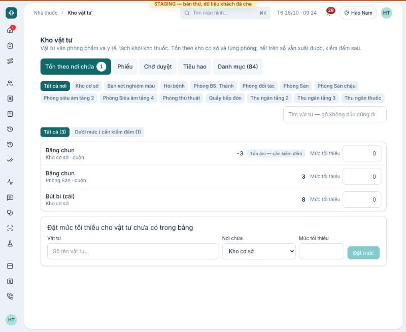

- **Vào bằng:** Menu Kho vật tư → tab Tồn theo nơi chứa
- **Có gì:** Chip chọn nơi: Kho cơ sở, các phòng; từng vật tư và mức tối thiểu; ô Đặt mức tối thiểu cho vật tư chưa có trong bảng.
- **Cần theo dõi:** Tồn âm hiện nhãn Tồn âm – cần kiểm đếm (vật tư đã xuất nhiều hơn sổ ghi). Lọc Dưới mức / cần kiểm đếm.
- **Bấm → tới đâu:** Sửa mức tối thiểu ngay trên dòng.

### Lập phiếu vật tư

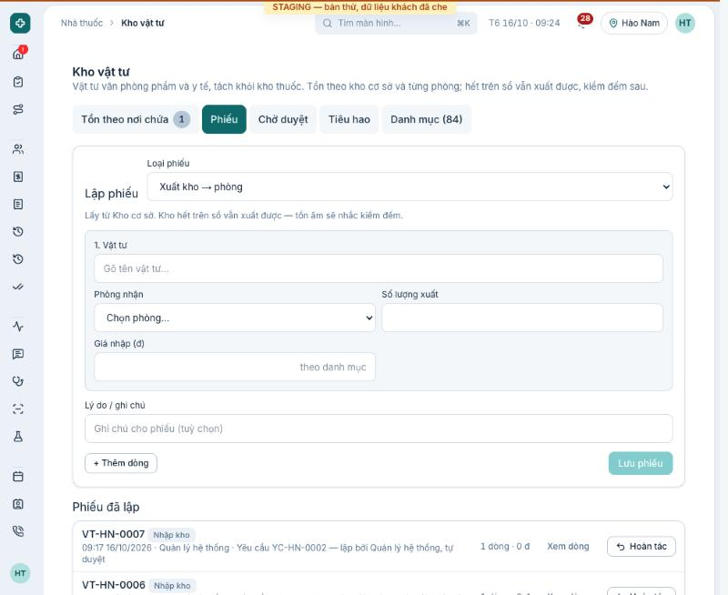

- **Vào bằng:** Kho vật tư → tab Phiếu
- **Có gì:** Loại phiếu (Xuất kho → phòng, nhập kho…), vật tư, phòng nhận, số lượng; danh sách phiếu đã lập (VT-HN-…) kèm nút Hoàn tác.
- **Cần theo dõi:** Xuất từ kho cơ sở; hết tồn trên sổ thì vẫn xuất được nhưng báo cần kiểm đếm.
- **Bấm → tới đâu:** Lưu phiếu → trừ kho cơ sở, cộng phòng nhận.

### Chờ duyệt

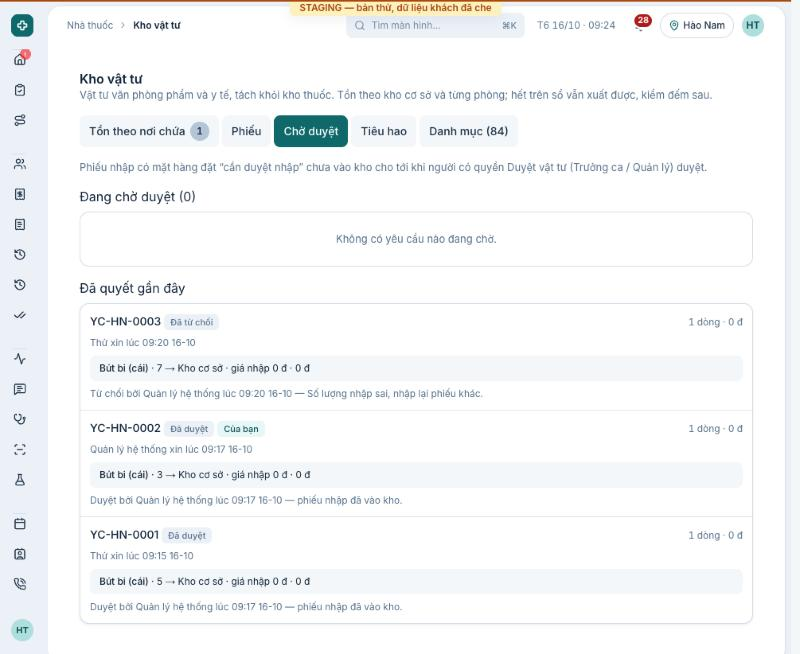

- **Vào bằng:** Kho vật tư → tab Chờ duyệt
- **Có gì:** Phiếu nhập vật tư của mặt hàng bật Cần duyệt nhập chờ người có quyền Duyệt vật tư. Đã quyết gần đây: YC-HN-0001 duyệt, YC-HN-0002 duyệt (tự duyệt của tài khoản có quyền), YC-HN-0003 từ chối kèm lý do.
- **Cần theo dõi:** Từ chối phải ghi lý do (≥ 5 ký tự). Phiếu bị từ chối không vào kho.
- **Bấm → tới đâu:** Duyệt → vật tư vào kho cơ sở; Từ chối → lý do hiện cho người xin.

### Tiêu hao

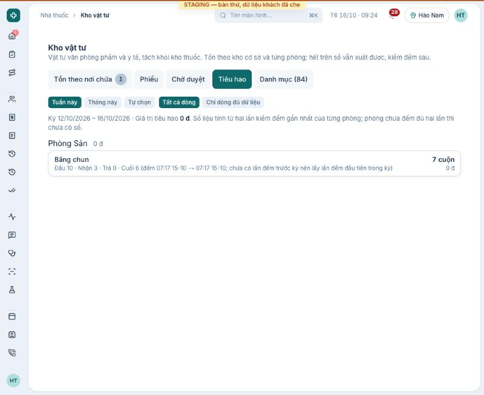

- **Vào bằng:** Kho vật tư → tab Tiêu hao
- **Có gì:** Giá trị tiêu hao theo phòng và theo kỳ (Tuần này, Tháng này, Tự chọn); chỉ tính khi đủ hai lần kiểm đếm gần nhất của phòng.
- **Cần theo dõi:** Phòng chưa đếm đủ hai lần thì ghi rõ chưa tính được, không đoán.
- **Bấm → tới đâu:** Chọn kỳ để đổi số liệu.

### Danh mục vật tư

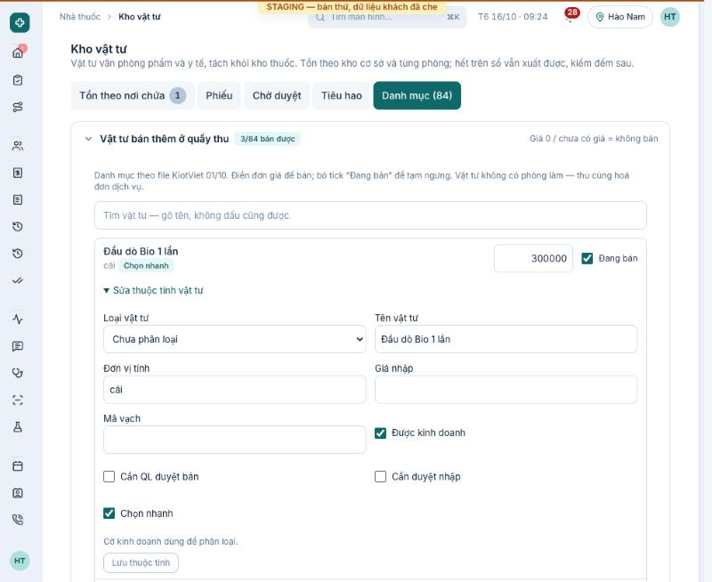

- **Vào bằng:** Kho vật tư → tab Danh mục
- **Có gì:** Mỗi vật tư: giá bán, tick Đang bán; bấm Sửa thuộc tính vật tư mở loại, tên, đơn vị, giá nhập, mã vạch, Được kinh doanh, Cần QL duyệt bán, Cần duyệt nhập.
- **Cần theo dõi:** Thuộc tính chỉ lưu khi bấm Lưu thuộc tính trong khung đó; tick ngoài khung không lưu.
- **Bấm → tới đâu:** Lưu thuộc tính vật tư → áp ngay cho phiếu và Thu tiền.

## 4. Khách hàng và CSKH

### Quản lý khách hàng

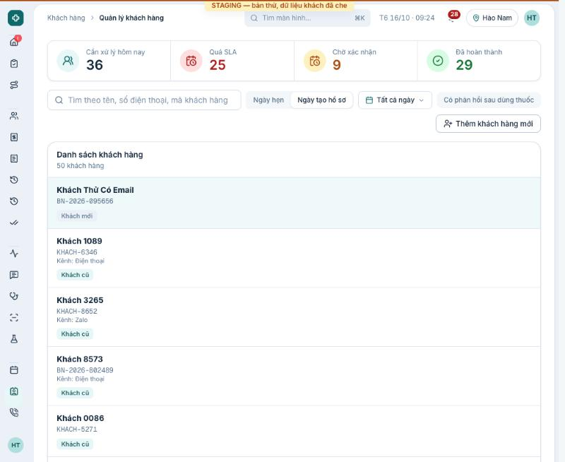

- **Vào bằng:** Menu Quản lý khách hàng
- **Có gì:** Bốn ô đếm việc CSKH (cần xử lý hôm nay, quá SLA, chờ xác nhận, đã hoàn thành), ô tìm, bộ lọc Ngày hẹn / Ngày tạo hồ sơ, chip Có phản hồi sau dùng thuốc, danh sách khách.
- **Cần theo dõi:** Quá SLA (đỏ) là việc trễ thật; chờ xác nhận là việc Gọi xác nhận lịch cho lịch đặt hộ.
- **Bấm → tới đâu:** Thêm khách hàng mới → form tạo hồ sơ. Bấm tên khách → hồ sơ khách.

### Tạo hồ sơ khách

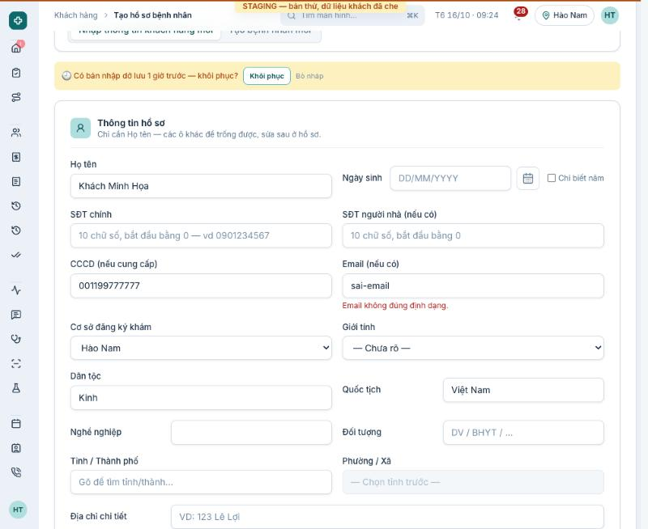

- **Vào bằng:** Quản lý khách hàng → Thêm khách hàng mới
- **Có gì:** Họ tên, ngày sinh, SĐT, CCCD, Email (nếu có), cơ sở, giới tính, địa chỉ. Email sai định dạng báo ngay dưới ô.
- **Cần theo dõi:** Chỉ cần họ tên; các ô khác để trống được. Bản nháp dở được giữ lại và hỏi Khôi phục.
- **Bấm → tới đâu:** Lưu hồ sơ, rồi Đặt lịch hoặc chuyển sang Quản lý khách hàng.

### Gọi xác nhận lịch

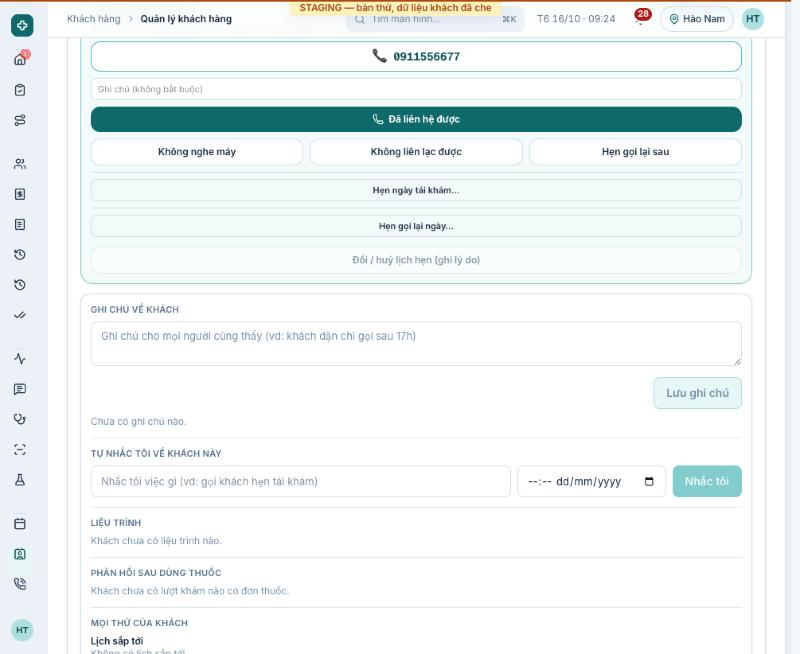

- **Vào bằng:** Hồ sơ khách (khối việc CSKH)
- **Có gì:** Số điện thoại, Ghi chú, các nút kết quả cuộc gọi: Đã liên hệ được, Không nghe máy, Không liên lạc được, Hẹn gọi lại sau, Hẹn ngày tới khám, Đổi / huỷ lịch hẹn. Ô Ghi chú về khách và Tự nhắc tôi.
- **Cần theo dõi:** Mọi lịch đặt hộ đều thành việc Gọi xác nhận lịch; mỗi cuộc gọi để lại dấu vết người gọi + giờ.
- **Bấm → tới đâu:** Bấm kết quả → việc đóng và ghi vào Tương tác gần nhất.

### Chuỗi việc trước, tại quầy, sau khám

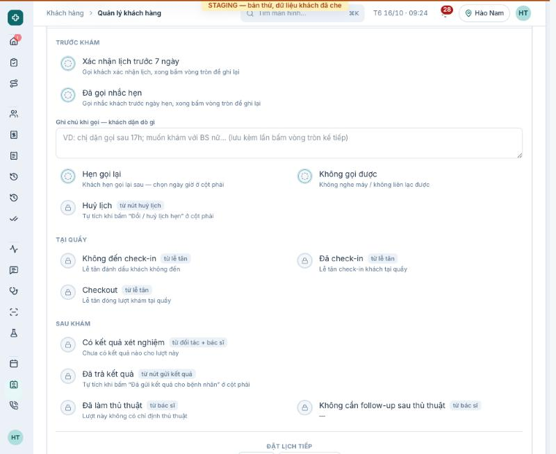

- **Vào bằng:** Hồ sơ khách, kéo xuống
- **Có gì:** Các việc trước khám (xác nhận lịch trước 7 ngày, nhắc hẹn), tại quầy (không đến, check-in, checkout), sau khám (có kết quả xét nghiệm, đã trả kết quả, đã làm thủ thuật, không cần follow-up).
- **Cần theo dõi:** Ô có nhãn từ lễ tân / từ bác sĩ tự tick từ thao tác thật; tick tay ở đây không tạo dữ liệu.
- **Bấm → tới đâu:** Đặt lịch tiếp ở cuối khối.

### Hồ sơ khách: CCCD và Email

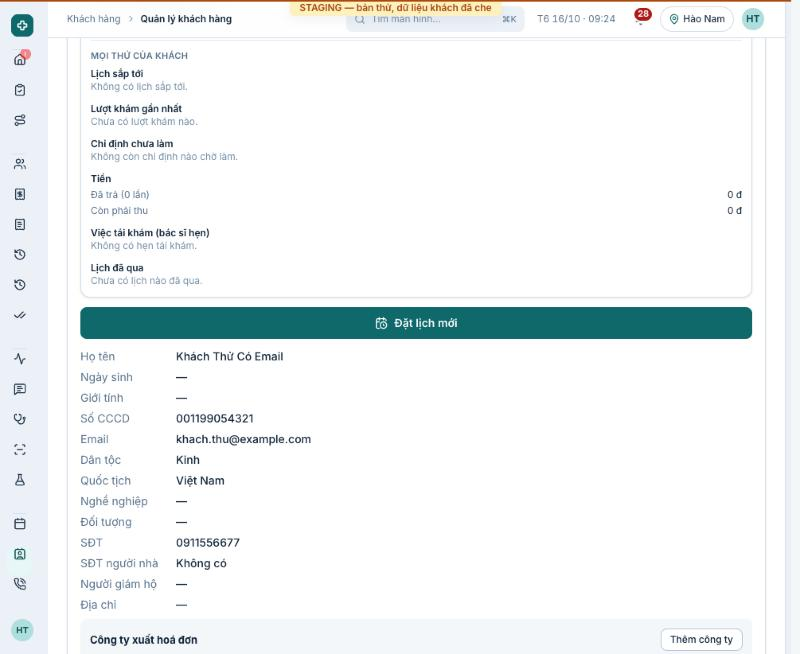

- **Vào bằng:** Hồ sơ khách, kéo xuống
- **Có gì:** Mọi thứ của khách: lịch sắp tới, lượt khám gần nhất, chỉ định chưa làm, tiền, việc tái khám, lịch đã qua; bảng thông tin có CCCD, Email, SĐT, người giám hộ, địa chỉ. Khối Công ty xuất hoá đơn.
- **Cần theo dõi:** Số tiền Đã trả và Còn phải thu ở khối Tiền.
- **Bấm → tới đâu:** Đặt lịch mới; Thêm công ty để xuất hoá đơn công ty.

### Phản hồi sau dùng thuốc

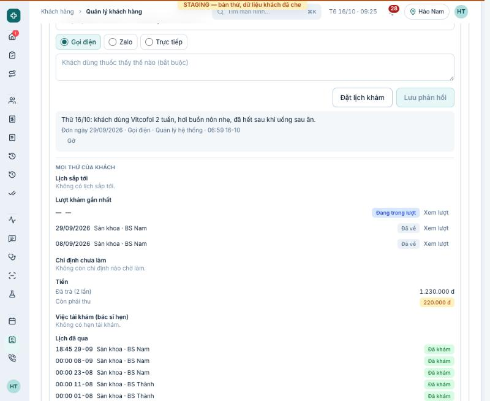

- **Vào bằng:** Hồ sơ khách
- **Có gì:** Chọn kênh Gọi điện / Zalo / Trực tiếp, ghi khách dùng thuốc thế nào, rồi Lưu phản hồi. Phản hồi cũ hiện ngay dưới kèm người ghi và giờ.
- **Cần theo dõi:** Phản hồi gắn với đơn thuốc gần nhất; bác sĩ thấy lại ở Bàn khám.
- **Bấm → tới đâu:** Lưu phản hồi → hiện ở Bàn khám và lọc được ở danh sách khách.

### Lọc khách có phản hồi thuốc

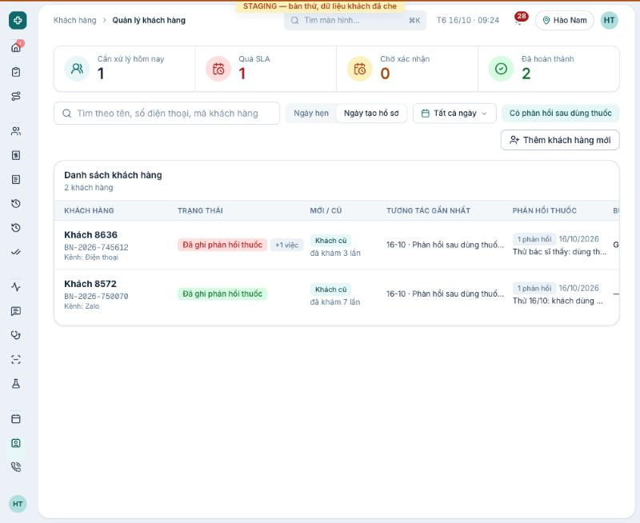

- **Vào bằng:** Quản lý khách hàng → chip Có phản hồi sau dùng thuốc
- **Có gì:** Chỉ khách đã có phản hồi; cột Phản hồi thuốc, Tương tác gần nhất, trạng thái Đã ghi phản hồi thuốc.
- **Cần theo dõi:** Dùng để theo dõi khách phản ứng với thuốc.
- **Bấm → tới đâu:** Bấm tên khách → hồ sơ.

## 5. Tài khoản và quản lý hệ thống

### Menu tài khoản

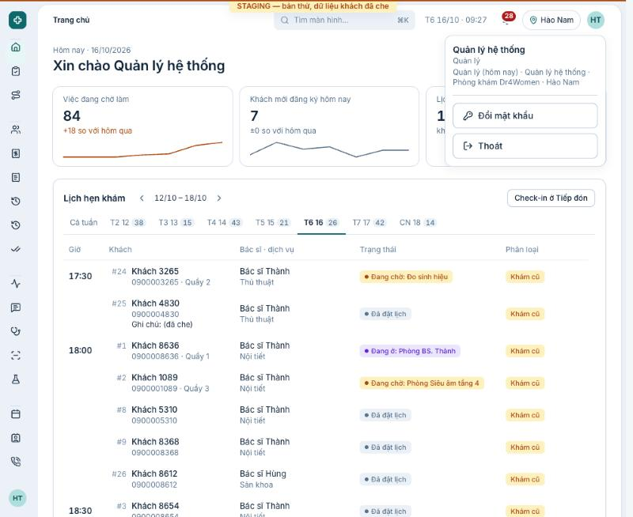

- **Vào bằng:** Bấm ảnh đại diện (góc phải trên)
- **Có gì:** Tên, vai trò, cơ sở đang chọn, Đổi mật khẩu, Thoát.
- **Cần theo dõi:** Đổi cơ sở ở nút cơ sở bên cạnh.
- **Bấm → tới đâu:** Đổi mật khẩu → hộp thoại bên dưới.

### Đổi mật khẩu cá nhân

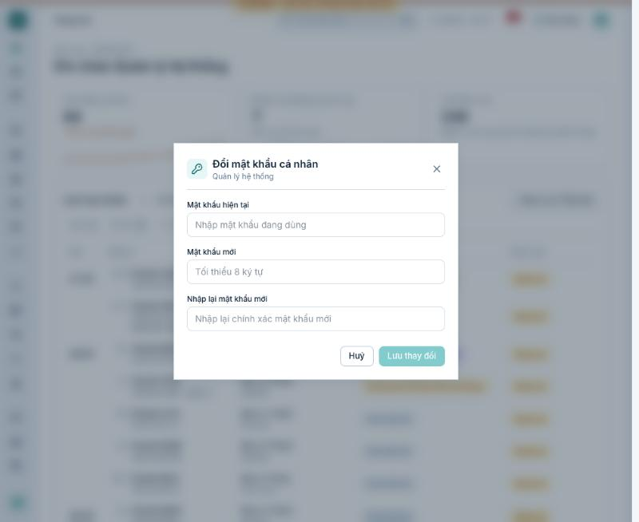

- **Vào bằng:** Menu tài khoản → Đổi mật khẩu
- **Có gì:** Mật khẩu hiện tại, Mật khẩu mới (tối thiểu 8 ký tự), Nhập lại.
- **Cần theo dõi:** Nút Lưu thay đổi chỉ sáng khi đủ ba ô. Hộp thoại nằm giữa màn hình, không bị cắt ở màn nhỏ.
- **Bấm → tới đâu:** Tuyền tự bấm bước nhập mật khẩu; Claude không nhập hộ.

### Thiết lập tài khoản cho nhân viên

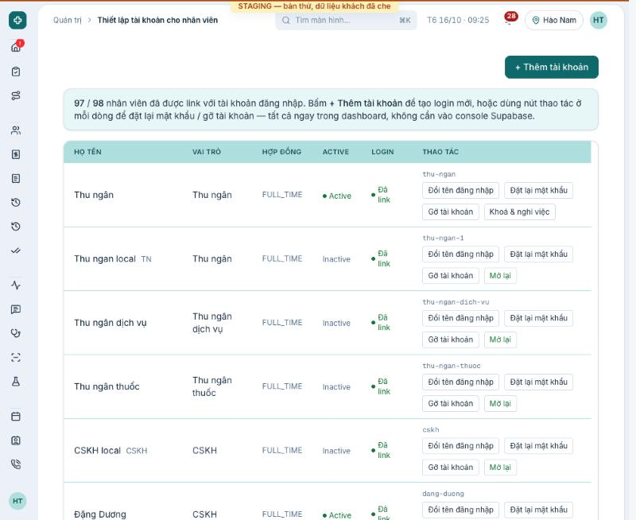

- **Vào bằng:** Màn Thiết lập tài khoản cho nhân viên (chỉ Quản lý hệ thống)
- **Có gì:** Danh sách nhân viên, vai trò, hợp đồng, trạng thái, nút Đổi tên đăng nhập, Đặt lại mật khẩu, Gỡ tài khoản / Mở lại; nút Thêm tài khoản.
- **Cần theo dõi:** Dòng tóm tắt 97 / 98 nhân viên đã có tài khoản.
- **Bấm → tới đâu:** Tuyền tự bấm các nút này (tạo, đặt lại, gỡ).

### Quản lý nhân sự

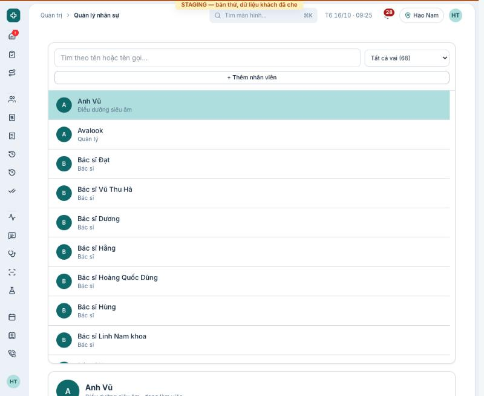

- **Vào bằng:** Menu Quản lý nhân sự
- **Có gì:** Danh sách nhân sự theo vai (68), ô tìm, Thêm nhân viên.
- **Cần theo dõi:** Bấm tên mở hồ sơ nhân sự.
- **Bấm → tới đâu:** Hồ sơ nhân sự → lịch trực và quyền.

### Cấu trúc phòng khám

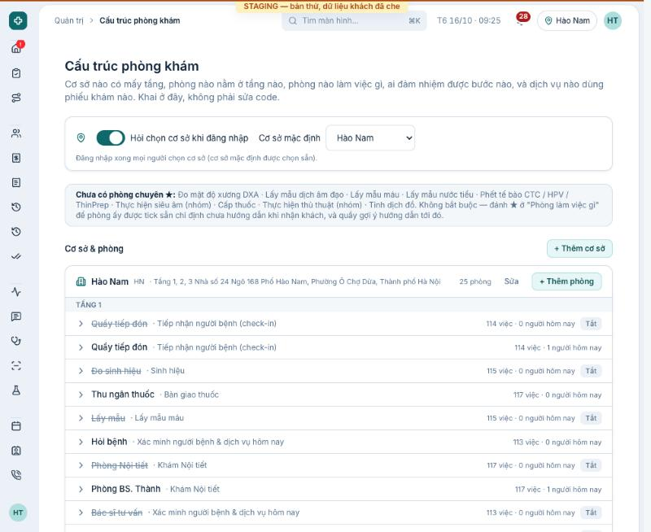

- **Vào bằng:** Menu Cấu trúc phòng khám
- **Có gì:** Cơ sở, tầng, phòng, việc từng phòng đảm nhiệm, số việc hôm nay, nút Tắt / Thêm phòng.
- **Cần theo dõi:** Chỉ cơ sở đang chạy mới hiện trong lựa chọn. Cơ sở đã ngừng không còn trong báo cáo.
- **Bấm → tới đâu:** Thêm cơ sở / Thêm phòng.

### Bảng giá dịch vụ và phòng

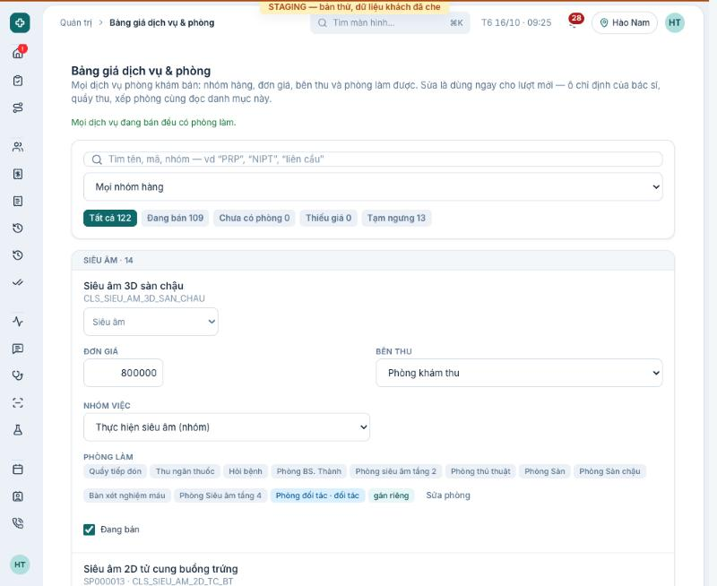

- **Vào bằng:** Menu Bảng giá dịch vụ & phòng
- **Có gì:** Nhóm hàng, đơn giá, bên thu, nhóm việc, phòng làm được; chip Đang bán, Chưa có phòng, Thiếu giá, Tạm ngưng.
- **Cần theo dõi:** Dịch vụ thiếu giá hoặc chưa có phòng làm sẽ không bán / xếp phòng được.
- **Bấm → tới đâu:** Sửa tại chỗ rồi Lưu.

### Phân quyền

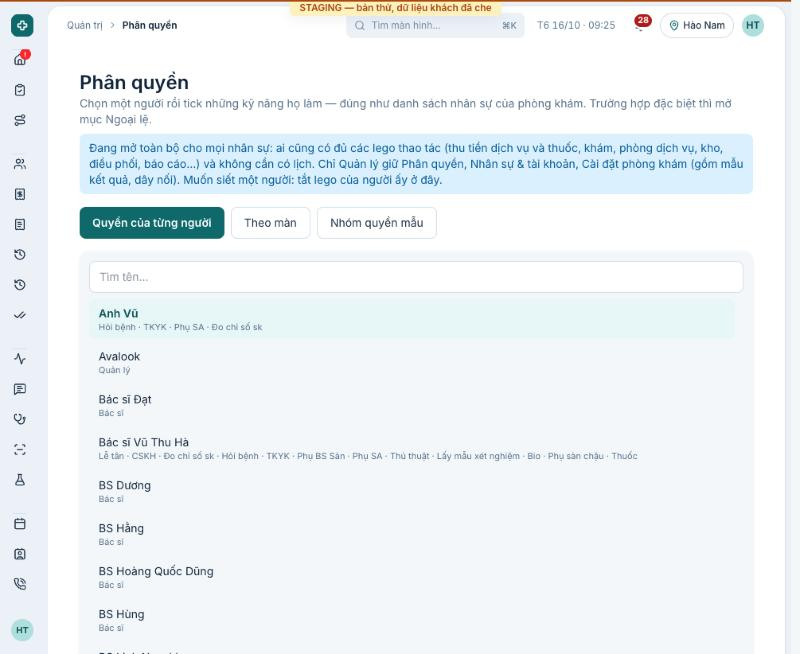

- **Vào bằng:** Menu Phân quyền
- **Có gì:** Quyền theo từng người, theo màn, nhóm quyền mẫu. Đang mở rộng mọi quyền thao tác cho mọi nhân sự; chỉ giữ Phân quyền, Nhân sự và tài khoản, Cài đặt cho người quản lý.
- **Cần theo dõi:** Muốn siết một người: tắt lego của người đó.
- **Bấm → tới đâu:** Chọn người → tick quyền (Duyệt vật tư, Kế toán…).

### Dây nối nghiệp vụ

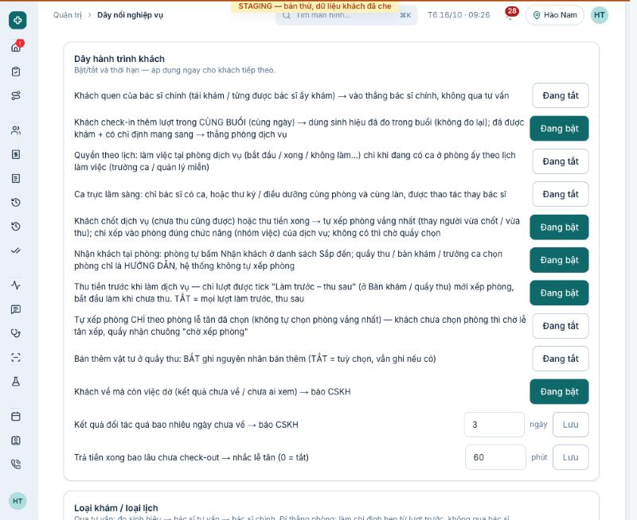

- **Vào bằng:** Menu Dây nối nghiệp vụ (Cài đặt)
- **Có gì:** Các công tắc hành trình khách: Nhận khách tại phòng đang bật, Thu trước – làm sau, Tự xếp phòng, Bán thêm vật tư… kèm ô số ngày / phút (nhắc trả kết quả, nhắc lễ tân).
- **Cần theo dõi:** Mỗi công tắc ghi rõ khi bật thì hệ thống làm gì.
- **Bấm → tới đâu:** Gạt công tắc → áp ngay.

## 6. Thu ngân, phòng dịch vụ, bàn khám

### Thu tiền dịch vụ

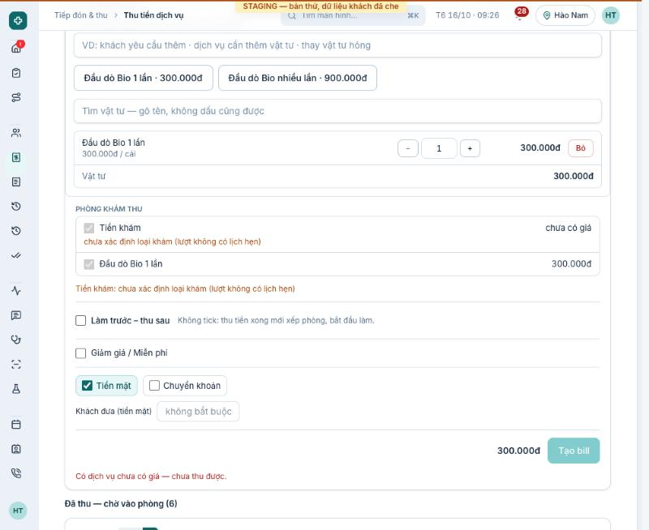

- **Vào bằng:** Menu Thu tiền dịch vụ
- **Có gì:** Chip bán nhanh Đầu dò Bio 1 lần (300.000đ) / nhiều lần; dòng vật tư; nhóm Phòng khám thu (tiền khám, Đầu dò Bio); Làm trước – thu sau, Giảm giá / Miễn phí, Tiền mặt / Chuyển khoản; Tạo bill.
- **Cần theo dõi:** Dòng đỏ báo dịch vụ chưa có giá hoặc chưa xác định loại khám.
- **Bấm → tới đâu:** Tạo bill → khách chuyển sang Đã thu – chờ vào phòng.

### Việc của đối tác

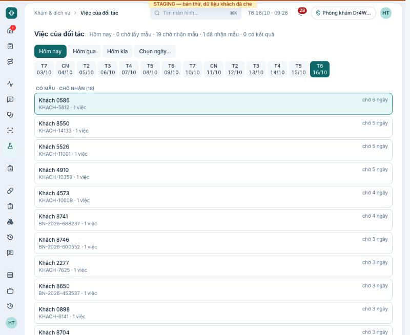

- **Vào bằng:** Menu Việc của đối tác
- **Có gì:** Danh sách khách có mẫu / việc gửi đối tác theo ngày, nhóm chờ nhận mẫu, đã nhận mẫu, có kết quả.
- **Cần theo dõi:** Việc chờ lâu hiện số ngày. Phòng đối tác không nhận qua nút Nhận; đi đường này.
- **Bấm → tới đâu:** Bấm khách → xử lý mẫu.

### Phòng dịch vụ (siêu âm tầng 2)

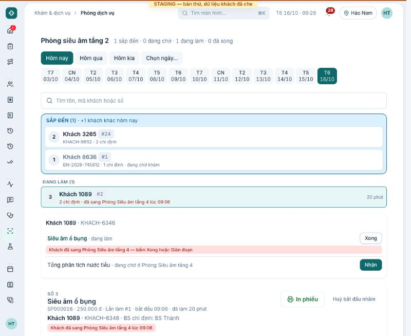

- **Vào bằng:** Menu Phòng dịch vụ → chọn phòng
- **Có gì:** Sắp đến, đang làm, đã xong; thao tác Xong, Gián đoạn, Nhận. Nhãn đỏ khi khách đã sang phòng khác.
- **Cần theo dõi:** Nhãn Khách đã sang phòng siêu âm tầng 4 là cảnh báo thật: bấm Xong hoặc Gián đoạn.
- **Bấm → tới đâu:** Xong → khách chuyển bước; Nhận → khách vào phòng.

### Danh sách phòng dịch vụ

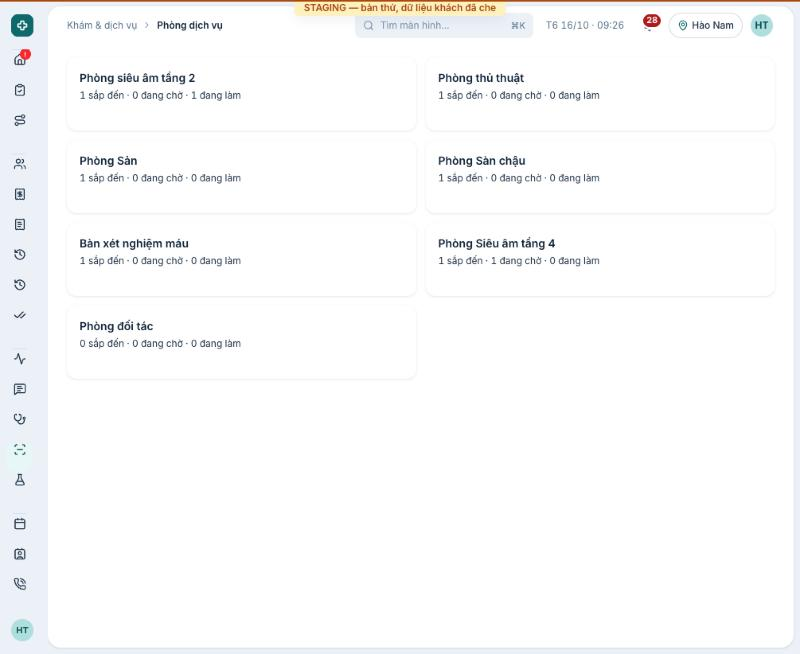

- **Vào bằng:** Menu Phòng dịch vụ
- **Có gì:** Thẻ từng phòng: sắp đến / đang chờ / đang làm.
- **Cần theo dõi:** Phòng nào đang có khách chờ nhìn được ở một chỗ.
- **Bấm → tới đâu:** Bấm thẻ → vào phòng.

### Bàn khám: phản hồi thuốc và hành trình

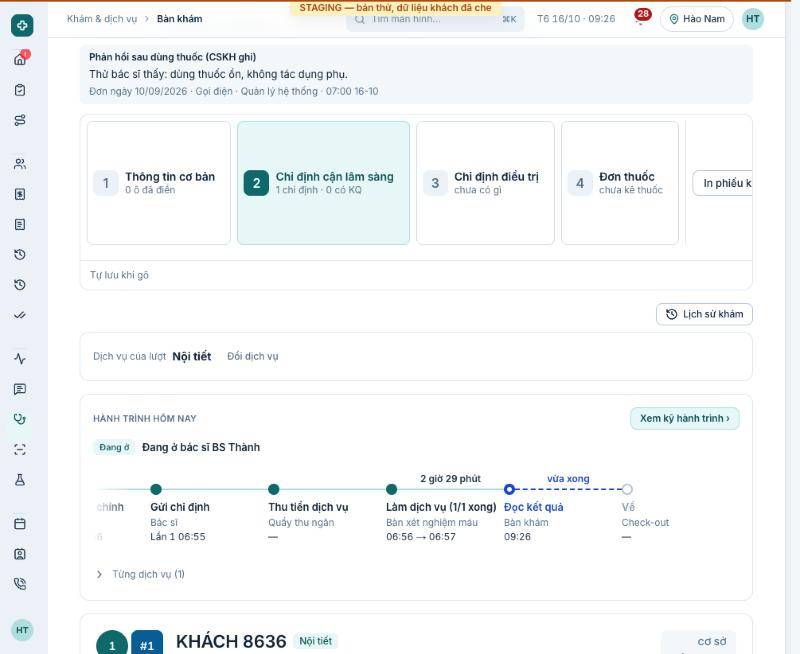

- **Vào bằng:** Menu Bàn khám → chọn khách
- **Có gì:** Hộp Phản hồi sau dùng thuốc (CSKH ghi), thanh bước Thông tin cơ bản · Chỉ định cận lâm sàng · Chỉ định điều trị · Đơn thuốc, khối Hành trình hôm nay với mốc thời gian.
- **Cần theo dõi:** Bác sĩ đọc phản hồi của CSKH trước khi kê đơn tiếp.
- **Bấm → tới đâu:** Xem kỹ hành trình → chi tiết từng bước; Lịch sử khám.

### Chỉ định Bio ở Bàn khám

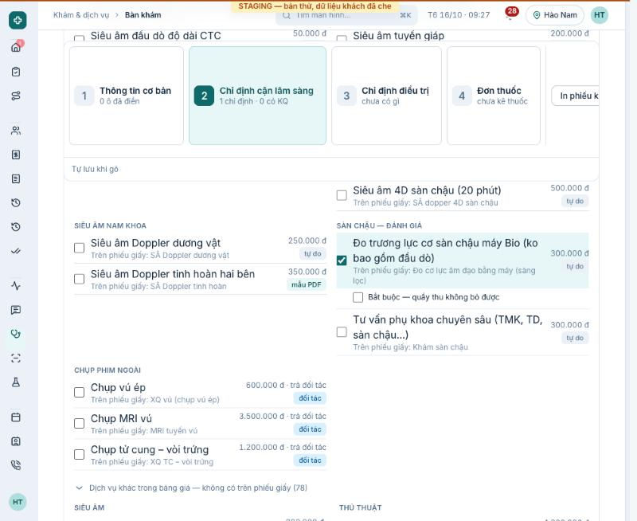

- **Vào bằng:** Bàn khám → Chỉ định cận lâm sàng
- **Có gì:** Danh sách dịch vụ theo nhóm; mục Đo trương lực cơ sàn chậu máy Bio (300.000đ, đã bao gồm đầu dò) kèm tick Bắt buộc.
- **Cần theo dõi:** Đầu dò Bio có ở Bàn khám và cả ở Thu ngân để khách mua thêm.
- **Bấm → tới đâu:** Tick dịch vụ → thêm vào chỉ định.

